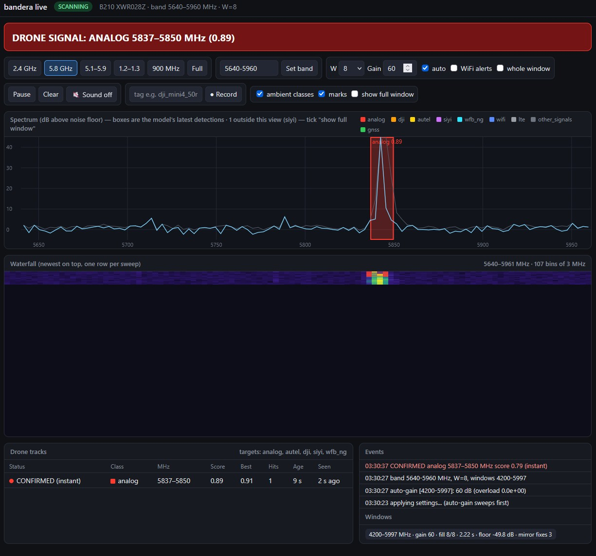
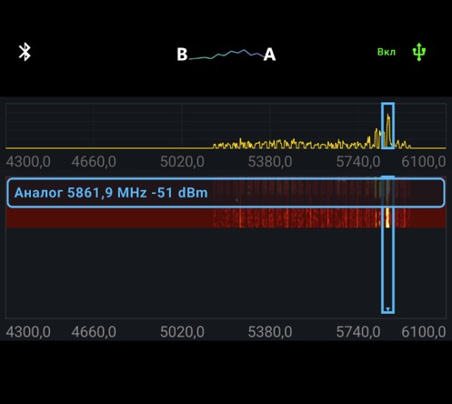

# Bandera

*Якщо ти справді покладаєшся на це лайно, щоб виживати щодня, — мені тебе шкода.*

Reverse engineering work of **"Frontera"**, an Android drone detector by **NPO Apogei**, as well as two open hardware backends that feed its
on-device ML: a UHD-compatible SDR (defaulting to the LibreSDR **B210**) and an **ESP32-C5**.

**For research, interoperability, and personal use.**

Thanks to amoswap and tt_125!!

---

## Demo:

**Extracted models detecting a 5.8 GHz FM analog FPV video transmission**

**Modified ~~Front~~Bandera app detecting Analog FPV video using the ESP32-C5 based SDR over USB**

## Background: Frontera / NPO Apogei

**NPO Apogei** (НПО «Апогей») is a russian company that sells ["Frontera-ML": a free Android app that
turns a **cheap handheld spectrum analyzer**](https://t.me/kbrtb_uav/126) (Arinst SSA / SA6-class clones, or their own "Frontera"
unit, reaching ~10–12 GHz with an add-on downconverter Horizont-12) plus a phone into a drone detector.

> How it works: the analyzer sweeps RF and streams the spectrum over USB serial; the app runs an
>on-device neural net to flag drone video/control links and raise an alert (screen, smartwatch,
>Bluetooth audio). **No internet, no raw I/Q** — just power-vs-frequency sweeps. It never ingests SDR
>samples; it "sees" drones purely in the spectrum.

## The ML models (`models/`)

- `RY_0_1_6_s_soup8b_rowsums_w{8,10,12,16}_fp32.tflite`: Encoder that summarizes W sweeps. All four share the same weights; only the summarizing step differs per W.
- `RY_0_1_6_s_soup8b_detect_fp32.tflite`: 1,064,068-byte detector with 256,016 exported convolution weights and biases.

The detector is a small **LiteRT / TFLite** model (tag `RY_0_1_6_s_soup8b`, with embedded names identifying a PyTorch / LiteRT Torch export path) in
two stages:

1. an **encoder** that summarizes W consecutive spectrum sweeps (mean / variance / max / burstiness), and
2. a **1-D detector** that outputs, per frequency, an objectness score plus **9 class scores**.

Classes: `analog, dji, autel, siyi, wifi, lte, other_signals, gnss, wfb_ng`. It alerts on the drone
ones — **analog FPV video, DJI, Autel, Siyi/Skydroid, and WFB-NG** (the open digital FPV link) — while
`lte`, `gnss`, and `wifi` act as "known, not a drone" so look-alikes don't false-alarm.

What's interesting about it:

- It works on a **3 MHz-binned, 1800 MHz-wide** power spectrum, not I/Q.
- It has **no absolute-frequency input** — it classifies by a signal's **spectral shape** and how it
  **flickers sweep-to-sweep** (a bursty TDD video link looks different from steady Wi-Fi). So a class
  can fire at any frequency.
- Everything is **floor-relative**, so absolute calibration barely matters; SNR does.

The pipeline here is a faithful re-implementation, verified against the app's own bundled "golden"
sample to `~1e-4`.

The encoder and detector together contain 266,232 exported convolution coefficients.
The user manual describes further training from users' labeled recordings of missed detections
and false alarms. The original training-set size and full recipe remain undisclosed in the
inspected sources. See the [model architecture and training evidence audit](docs/model-training-audit-2026-10-26.md)
for exact sizes, tensor shapes, the app's labeled recording format, and the limits of what can be recovered.

## What's in this repo

| Folder | What |
|---|---|
| `models/` | The extracted detector + the self-test golden file. |
| `sdr/` | Run the detector on a **PC with a UHD SDR**: optimized B210 and generic receive backends, an Arinst serial adapter, recording/replay, and a **live web UI**. |
| `esp32-sdr-arinst/` | Firmware that makes a **Seeed XIAO ESP32-C5** act as the analyzer — it speaks the Arinst serial protocol natively, using the chip's hidden Wi-Fi-radio SDR mode (built on [esp-sdr](https://github.com/ESPARGOS/esp-sdr) / [widscan58](https://github.com/CapnBry/widscan58)). ~$7, self-powered, detects analog FPV at 5.8 GHz and DJI Mavic 3 at 2.4 GHz. |
| `patcher/` | Turn the stock Frontera APK into **Bandera** and publish it as a release. |

Each folder has its own README.

## Bandera App:

The patcher modifies the app to accept the **ESP32-C5** as its analyzer. A simple modification allows the app to see the ESP32 as an Arinst/Frontera SA.

The GitHub Action (`workflow_dispatch`) downloads the stock APK from a configured URL, patches it,
stamps the current `main` commit SHA as the app version, and publishes the result as a GitHub
release. Builds are debug-signed for sideloading.

## Status

- **2026-10-26 receive validation:** corrected C5 firmware returns complete 600-point sweeps in
  0.41–0.44 s and identifies the 5805 MHz analog camera in 17/17 overlapping W=8 windows.
  The default B210 profile takes 1.27–1.91 s in the longer test and identifies analog in all
  nine W=16 windows. These are bounded bench observations, not a general accuracy estimate.
- The patched APK now covers C5 automatic USB presence/permission checks as well as manual
  discovery. An in-place update on the Pixel 10 passed live spectrum/waterfall, analog-camera
  detection, USB reconnect, and stop/start checks. Unverified labels elsewhere in the band
  remain a measurement-fidelity issue; the phone test does not establish false-positive rates.
- The extracted models remain unchanged and pass every bundled golden check. Further work
  focuses on measurement fidelity, RF calibration and real DJI 2.4 GHz captures.
- See [validation results](docs/validation-2026-10-26.md), the
  [Arinst protocol audit](docs/protocol-research.md), and [remaining work](TODO.md).

## Donate:

Fundraiser to help counter reactive shaheds: https://www.sternenkofund.org/en/fundraisings/operaciya-perehoplennya
